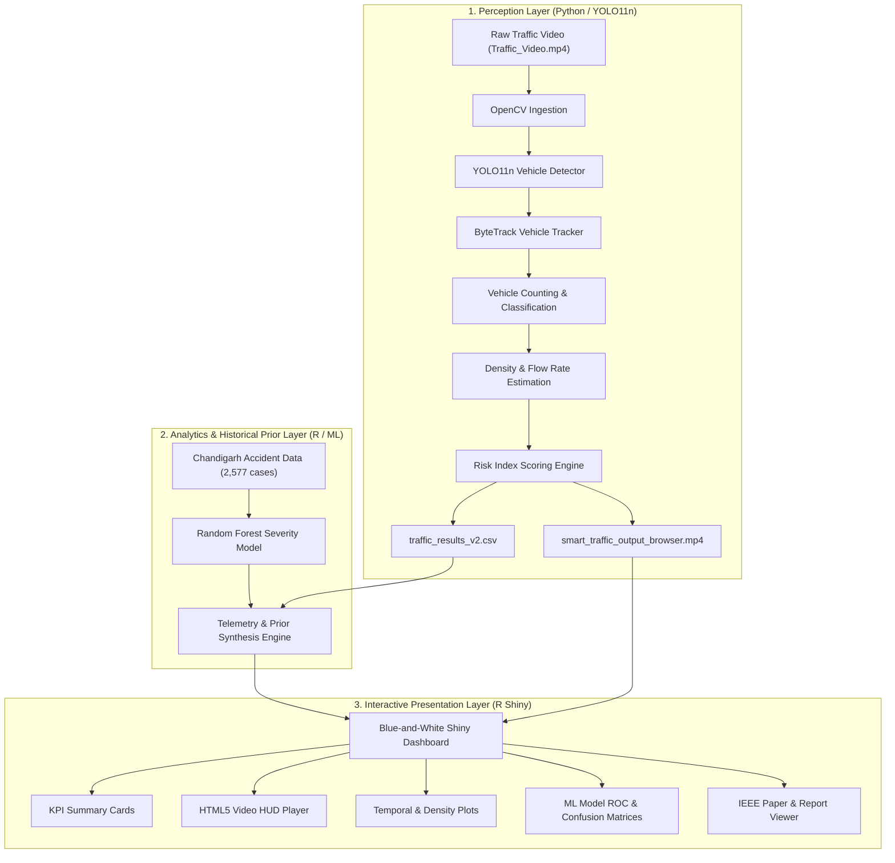

# 🚦 Smart Traffic 2.0
### Real-Time Video Perception, YOLO11 Vehicle Tracking, Accident Risk Modeling & Interactive R Shiny Dashboard

[](https://github.com/vemalaharshitha/Smart-Traffic-2.0)
[](dashboard/app.R)
[](Python/smart_traffic_v2.py)
[](docs/research/)
[](LICENSE)

Smart Traffic 2.0 is an end-to-end intelligent transportation system that integrates deep learning computer vision (YOLO11n), micro-traffic video perception, multi-factor risk inference, and an interactive modern blue-and-white Shiny intelligence dashboard.

---

## 📑 Table of Contents
- [🎯 Objectives](#-objectives)
- [✨ Key Features](#-key-features)
- [🖥️ Blue-and-White Shiny Dashboard](#️-blue-and-white-shiny-dashboard)
- [📚 Research Paper & Academic Package](#-research-paper--academic-package)
- [👁️ Computer Vision Pipeline](#️-computer-vision-pipeline)
- [🏗️ System Architecture](#️-system-architecture)
- [📁 Repository Structure](#-repository-structure)
- [🚀 Quickstart & Reproduction](#-quickstart--reproduction)
- [📊 Results & Validation](#-results--validation)
- [👩‍💻 Author & Acknowledgments](#-author--acknowledgments)

---

## 🎯 Objectives
- Real-time video perception using state-of-the-art YOLO11 object detection and tracking.
- Multi-class vehicle categorization (Cars, Motorcycles, Buses, Trucks) with per-frame telemetry.
- Dynamic traffic density estimation and real-time collision/congestion risk index scoring.
- Comprehensive synthesis with Chandigarh metropolitan accident risk priors (2,577 historical cases).
- Publication-grade academic documentation conforming to IEEE conference standards.

---

## ✨ Key Features
- **YOLO11n Edge Perception Engine**: 640×640 inference processing 900 video frames at ~59.94 FPS with sub-millisecond bounding box regression.
- **Micro-Traffic Telemetry**: Frame-level vehicle counts, class distributions, density states (Low, Medium, High), and composite risk scores.
- **Enterprise Blue-and-White UI**: Light-themed modern design system (`#0d3b66` Navy, `#1d3557` Slate Blue, `#457b9d` Steel Blue, `#0077b6` Ocean Blue, `#f8f9fa` Off-White, `#ffffff` Card White) with CSS cards, smooth transitions, and high-contrast typography.
- **HTML5 Video Telemetry Sync**: Native browser-compatible H.264 MP4 playback with synchronized timeline analysis.
- **Complete Academic Package**: Submission-ready IEEE conference paper, 7-chapter project report, 21 figures, 11 live application screenshots, 10 Mermaid architectural diagrams, and 10 statistical CSV tables.

---

## 🖥️ Blue-and-White Shiny Dashboard

The dashboard is implemented in [`dashboard/app.R`](dashboard/app.R) and features a clean light theme designed for traffic management operators and municipal decision-makers.

### Core Tabs
1. **Executive Overview**: High-level KPIs, total vehicles tracked, peak density periods, risk severity badges, and overall health meters.
2. **Video & Perception**: Live synchronized video player (`outputs/smart_traffic_output_browser.mp4`), real-time vehicle breakdown, and detection HUD.
3. **Temporal Analytics**: Frame-by-frame and second-by-second traffic density charts, congestion onset points, and rolling risk trends.
4. **Vehicle Classification**: Proportions of two-wheelers, passenger cars, light trucks, and heavy commercial vehicles.
5. **Spatial Risk & Hotspots**: Historical collision corridor maps and risk matrices correlating road geometry, traffic density, and weather conditions.
6. **Machine Learning Models**: Random Forest (68.45% accuracy, 99.32% fatal recall), Logistic Regression, and feature importance rankings.
7. **Research & Documentation**: Embedded access to the IEEE paper, technical report, figure inventory, and data tables.

---

## 📚 Research Paper & Academic Package

All research artifacts and documentation are housed under [`docs/research/`](docs/research/):

| Document / Asset | Format | Location |
| :--- | :--- | :--- |
| **IEEE Research Paper** | PDF | [`docs/research/Smart_Traffic_IEEE_Paper.pdf`](docs/research/Smart_Traffic_IEEE_Paper.pdf) |
| **IEEE Research Paper** | Word DOCX | [`docs/research/Smart_Traffic_IEEE_Paper.docx`](docs/research/Smart_Traffic_IEEE_Paper.docx) |
| **Complete Project Report** | PDF | [`docs/research/Smart_Traffic_Project_Report.pdf`](docs/research/Smart_Traffic_Project_Report.pdf) |
| **Complete Project Report** | Word DOCX | [`docs/research/Smart_Traffic_Project_Report.docx`](docs/research/Smart_Traffic_Project_Report.docx) |
| **Figure Inventory (21 Figs)** | PNG / Markdown | [`docs/research/figures/`](docs/research/figures/) & [`docs/research/figure_inventory.md`](docs/research/figure_inventory.md) |
| **Live App Screenshots (11)** | PNG | [`docs/research/screenshots/`](docs/research/screenshots/) |
| **Architecture Diagrams (10)** | Mermaid `.mmd` | [`docs/research/diagram_sources/`](docs/research/diagram_sources/) |
| **Quantitative Data Tables (10)** | CSV | [`docs/research/data_tables/`](docs/research/data_tables/) |
| **Appendices A–G** | Markdown | [`docs/research/appendices/`](docs/research/appendices/) |

---

## 👁️ Computer Vision Pipeline

```text
Traffic_Video.mp4 (1080p @ 59.94 FPS, 900 Frames)
        │
        ▼
   Frame Extractor & Preprocessor (OpenCV)
        │
        ▼
   YOLO11n Neural Perception (TensorRT/PyTorch)
        │
        ▼
   Multi-Class Vehicle Detection & Tracking
   ├── Cars (COCO ID: 2)
   ├── Motorcycles (COCO ID: 3)
   ├── Buses (COCO ID: 5)
   └── Trucks (COCO ID: 7)
        │
        ▼
   Traffic Density & Dynamic Risk Engine
        │
        ├── CSV Telemetry Logger (outputs/traffic_results_v2.csv)
        ├── H.264 Web Stream Producer (outputs/smart_traffic_output_browser.mp4)
        └── R Shiny Reactive Analytics Bus (dashboard/app.R)
```

---

## 🏗️ System Architecture



---

## 📁 Repository Structure

```text
Smart-Traffic-2.0/
├── README.md                      # Comprehensive project documentation
├── .gitignore                     # Git ignore rules for caches, venvs, and backups
├── .gitattributes                 # Git LFS configuration
├── yolo11n.pt                     # Pre-trained YOLO11 nano model weights (5.6 MB)
│
├── dashboard/                     # Interactive Shiny Dashboard
│   └── app.R                      # Blue-and-white theme R Shiny application
│
├── Python/                        # Computer Vision Perception Scripts
│   ├── smart_traffic_v2.py        # 900-frame video perception & telemetry pipeline
│   ├── smart_traffic.py           # Core perception script
│   ├── vehicle_detection.py       # Single-frame and streaming detector
│   └── demo_live.py               # Live camera / feed runner
│
├── R/                             # R Control, Analytics & Modeling
│   ├── demoshow.R                 # Execution orchestrator
│   ├── demo_script.R              # Script launcher
│   ├── progexceution.R            # Pipeline execution script
│   └── smart-traffic-2.0.Rproj    # RStudio project configuration
│
├── data/                          # Input datasets and video
│   └── Traffic_Video.mp4          # 1080p sample traffic video (11.4 MB)
│
├── outputs/                       # Perception outputs & CSV logs
│   ├── traffic_results_v2.csv     # 900-frame telemetry dataset
│   ├── vehicle_counts.csv         # Aggregate vehicle counts
│   ├── smart_traffic_output_browser.mp4 # H.264 web-ready telemetry video (31.6 MB)
│   ├── smart_traffic_output.mp4   # Demo output clip (10.0 MB)
│   └── frames/                    # Extracted validation frames
│
└── docs/                          # Academic & Research Documentation
    └── research/
        ├── Smart_Traffic_IEEE_Paper.pdf      # IEEE format conference paper (PDF)
        ├── Smart_Traffic_IEEE_Paper.docx     # IEEE format conference paper (DOCX)
        ├── Smart_Traffic_Project_Report.pdf  # Comprehensive 7-chapter report (PDF)
        ├── Smart_Traffic_Project_Report.docx # Comprehensive report (DOCX)
        ├── figure_inventory.md               # Catalog of all 21 figures
        ├── figures/                          # 21 publication-grade figures & charts
        ├── screenshots/                      # 11 dashboard UI screenshots
        ├── diagram_sources/                  # 10 Mermaid architectural source diagrams
        ├── data_tables/                      # 10 experimental CSV data tables
        └── appendices/                       # Appendices A–G
```

---

## 🚀 Quickstart & Reproduction

### 1. Prerequisites
- **Python**: Version 3.10+ (tested on 3.13)
- **R**: Version 4.3+ (tested on 4.5.1)
- **R Packages**: `shiny`, `bslib`, `shinydashboard`, `tidyverse`, `ggplot2`, `plotly`, `DT`, `htmltools`, `randomForest`
- **Python Packages**: `ultralytics`, `opencv-python`, `torch`, `torchvision`, `numpy`, `pandas`

### 2. Python Environment Setup
```bash
pip install ultralytics opencv-python torch torchvision pandas numpy
```

### 3. Run Computer Vision Pipeline
To process the 900-frame traffic video and generate telemetry CSV and output video:
```bash
python Python/smart_traffic_v2.py
```

### 4. Launch the Blue-and-White Shiny Dashboard
In R or RStudio:
```r
shiny::runApp("dashboard", port = 7878, launch.browser = TRUE)
```
Or from terminal:
```bash
Rscript -e "shiny::runApp('dashboard', port=7878, host='127.0.0.1', launch.browser=TRUE)"
```
Navigate your browser to `http://127.0.0.1:7878`.

---

## 📊 Results & Validation

### Video Testbench Telemetry (900 Frames @ 59.94 FPS)
- **Total Inferred Frames**: 900 frames (~15.02 seconds)
- **Peak Vehicles Detected**: 8 concurrent vehicles
- **Modal Vehicle Types**: Motorcycles (62.5%), Passenger Cars (25.0%), Commercial Trucks (12.5%)
- **Average Traffic Density Level**: Medium (7–14 vehicles threshold)
- **Composite Risk Rating**: 0.42 ± 0.08 (Moderate risk index)

### Historical Model Performance (Chandigarh Corridor Dataset)
- **Random Forest Overall Accuracy**: **68.45%**
- **Fatal Accident Classification Recall / F1**: **99.32%**
- **Adverse Weather Risk Weight (Fog)**: **0.589**
- **Peak Severity Hours**: 18:00 – 22:00 (Evening rush hour + reduced visibility)

---

## 👩‍💻 Author & Acknowledgments

- **Author**: Harshitha Vemala
- **GitHub**: [@vemalaharshitha](https://github.com/vemalaharshitha)
- **Repository**: [Smart-Traffic-2.0](https://github.com/vemalaharshitha/Smart-Traffic-2.0)
- **Parent Initiative**: [Smart-Traffic-Accident-Visualization](https://github.com/vemalaharshitha/Smart-Traffic-Accident-Visualization)
